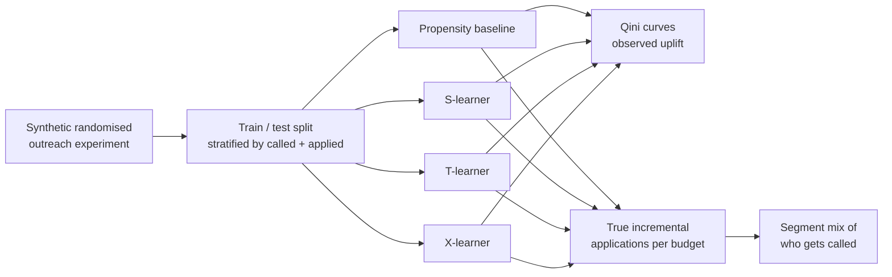
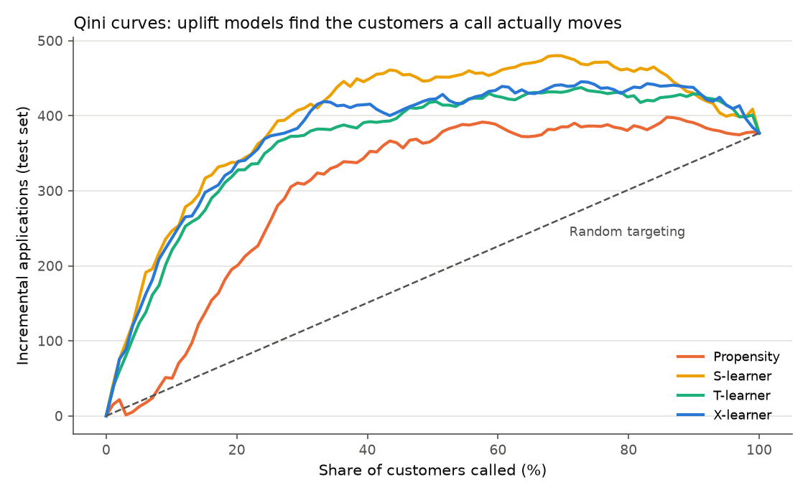
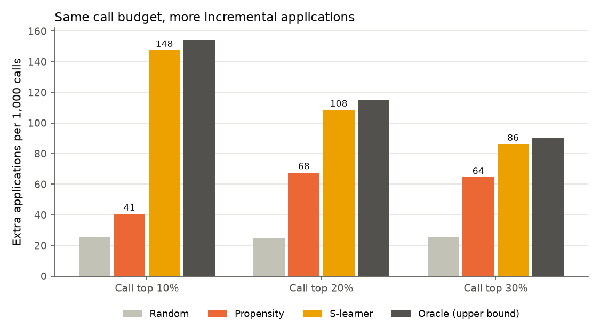
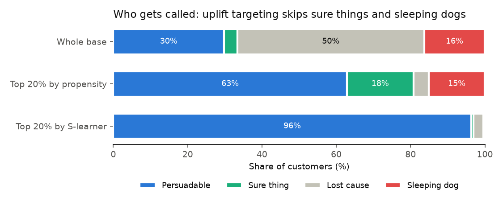

# Outreach Uplift Modelling

**Who should a lender call: the customers most likely to apply, or the customers a call actually changes?**

> **Part 2 of 4 in a lending AI series:** [1. Predict who will apply](https://github.com/Shru2006/first-home-buyer-lead-intelligence) → **2. Target who a call changes** → [3. Test the LLM's briefs](https://github.com/Shru2006/llm-brief-evals) → [4. Monitor it in production](https://github.com/Shru2006/model-monitoring-pipeline)

**At a glance:**
- Calling the top 20% of customers ranked by an **uplift model** buys **108 extra home loan applications per 1,000 calls**, against **68** for propensity ranking: **60% more from the same calls**, and 94% of the best possible.
- Propensity targeting spends a third of its calls on customers who would **apply anyway or are put off by the call**. Uplift targeting spends about 1% on them.
- S-, T- and X-learners are written by hand on LightGBM and scored two ways: with **Qini curves** (what a real experiment allows) and against the **known true uplift** (only possible with synthetic data).

`Python 3.12` · `LightGBM` · `causal inference` · `meta-learners (S / T / X)` · `Qini curves` · `GitHub Actions` · `pytest`

> **All data is synthetic**, generated by `src/generate_data.py`. It contains no real customer information. This is a personal portfolio project, not affiliated with or endorsed by any bank, and nothing here is financial advice.

---

## 1. The problem

[My first home buyer project](https://github.com/Shru2006/first-home-buyer-lead-intelligence) ranks customers by how likely they are to apply for a home loan. That answers *who will apply*, but the business decision is *who to call*, and those aren't the same question:

| Segment | If called | If not called | Should we call? |
|---|---|---|---|
| **Persuadable** | applies | doesn't apply | **Yes.** This is the only group a call helps |
| **Sure thing** | applies | applies anyway | No, the call is wasted |
| **Lost cause** | doesn't apply | doesn't apply | No, the call is wasted |
| **Sleeping dog** | doesn't apply | would have applied | **No, the call does harm** |

A propensity model ranks sure things at the top, because they're the most likely to apply. An **uplift model** estimates the *difference a call makes* for each customer, so it ranks persuadables first.

## 2. Approach

1. **A randomised experiment.** 80,000 synthetic customers, half called at random, outcome = applied within 90 days. Randomisation is what makes the causal effect estimable. Called customers apply at 10.2% vs 7.9% for those not called.
2. **Hidden ground truth.** The generator knows both potential outcomes for every customer, so models can be scored against the *true* uplift. That's impossible with real data, and it is why synthetic data is the right tool for comparing methods.
3. **Four ways to rank customers**, all on LightGBM ([`src/learners.py`](src/learners.py)), written by hand so every step is visible:
   - **Propensity baseline:** rank by P(apply), what most targeting does today.
   - **S-learner:** one model with "called" as a feature. Uplift = prediction if called − prediction if not.
   - **T-learner:** separate models for called and not-called customers.
   - **X-learner** (Künzel et al., 2019): T-learner first, then models each customer's imputed effect.
4. **Evaluation on 32,000 held-out customers** ([`src/evaluate.py`](src/evaluate.py)):
   - **Qini curves and coefficient:** what you can measure in a real experiment.
   - **Observed uplift in the top 20%:** application rate called − not called, within the targeted group.
   - **True incremental applications per 1,000 calls:** from the known ground truth.



## 3. Results (held-out test set, 32,000 customers)

| Ranking method | Qini coefficient | Observed uplift in top 20% | Extra applications per 1,000 calls (top 10%) | (top 20%) | (top 30%) |
|---|---|---|---|---|---|
| Random | 0.07 | +2.1 pts | 25 | 25 | 25 |
| Propensity (rank by P(apply)) | 0.30 | +6.5 pts | 41 | 68 | 64 |
| T-learner | 0.47 | +10.2 pts | 137 | 102 | 81 |
| X-learner | 0.50 | +10.4 pts | 142 | 105 | 83 |
| **S-learner** | **0.55** | **+10.6 pts** | **148** | **108** | **86** |
| *Oracle (true uplift, upper bound)* | *0.58* | *+11.7 pts* | *154* | *115* | *90* |

<p float="left">
  
  
</p>

**What propensity gets wrong:** in its top 10%, propensity finds only 41 extra applications per 1,000 calls, barely more than random (25), because that slice is full of sure things and over-contacted customers. Every uplift learner finds more than three times as many.



**Who gets called:** 33% of propensity's top 20% are sure things (18%) or sleeping dogs (15%), calls that are wasted or do harm. The S-learner's top 20% is 96% persuadables.

## 4. Responsible AI, design decisions and limitations

One-page summary: [model card](MODEL_CARD.md).

| Decision | Why |
|---|---|
| **Randomised treatment** in the data | Without randomisation, uplift is confounded by whoever lenders chose to call. In real life this needs a holdout group in every campaign. |
| **Report observed and true metrics side by side** | The Qini and observed uplift columns are what you could compute on a real experiment. The true columns check that those observable metrics pick the right model. Here they agree. |
| **Compare against propensity, not just random** | Beating random is easy. The business question is whether uplift beats what the team already does. |
| **The S-learner won here, and that's reported as is** | With small effects and plenty of data, a single model sharing information across groups is hard to beat. On other data the X-learner often wins, so the pipeline keeps all three. |

**Limitations:** the data is synthetic, so the results show the method works, not the size of the gain on a real customer base. One random train/test split is shown. Bootstrapped intervals and repeated splits are the next step. Call cost and capacity aren't modelled yet.

## 5. Run it yourself

```bash
git clone https://github.com/Shru2006/outreach-uplift-modelling.git
cd outreach-uplift-modelling
python -m venv .venv
.venv\Scripts\activate            # macOS/Linux: source .venv/bin/activate
pip install -r requirements.txt

python -m src.pipeline            # everything: experiment data, learners, reports
pytest -q                         # tests
```

Or step by step: `python -m src.generate_data`, then `python -m src.run`. No API key or paid service is needed.

## 6. Project structure

```
├── MODEL_CARD.md          purpose, inputs, performance, responsible use
├── src/
│   ├── config.py          paths, features, budgets
│   ├── generate_data.py   synthetic randomised experiment with known true uplift
│   ├── learners.py        propensity baseline, S-, T- and X-learners on LightGBM
│   ├── evaluate.py        Qini curve and coefficient, incremental per budget, segments
│   ├── run.py             train, evaluate, write metrics and charts
│   └── pipeline.py        runs every step
├── reports/               metrics.json, budget table, figures
├── tests/                 pytest checks (randomisation, leakage, learners beat random)
└── .github/workflows/     CI: tests + full pipeline on every push
```

## 7. What I would do next

- **Holdout groups in every campaign**, so uplift can be measured and the model retrained on fresh experimental data.
- **Cost-aware targeting:** call only where expected incremental value exceeds the cost of the call.
- **Uncertainty:** bootstrap the Qini coefficient and incremental counts, and compare learners across repeated splits.
- **Combine with the propensity model's reason codes** so lenders see *why* a call is likely to help, not just that it will.

---

**The series:** [1. Predict who will apply](https://github.com/Shru2006/first-home-buyer-lead-intelligence) · **2. Target who a call changes** · [3. Test the LLM's briefs](https://github.com/Shru2006/llm-brief-evals) · [4. Monitor it in production](https://github.com/Shru2006/model-monitoring-pipeline)

**Author:** Shruti Prabhu · [LinkedIn](https://www.linkedin.com/in/shruti-prabhu-32b77477) · [GitHub](https://github.com/Shru2006)
